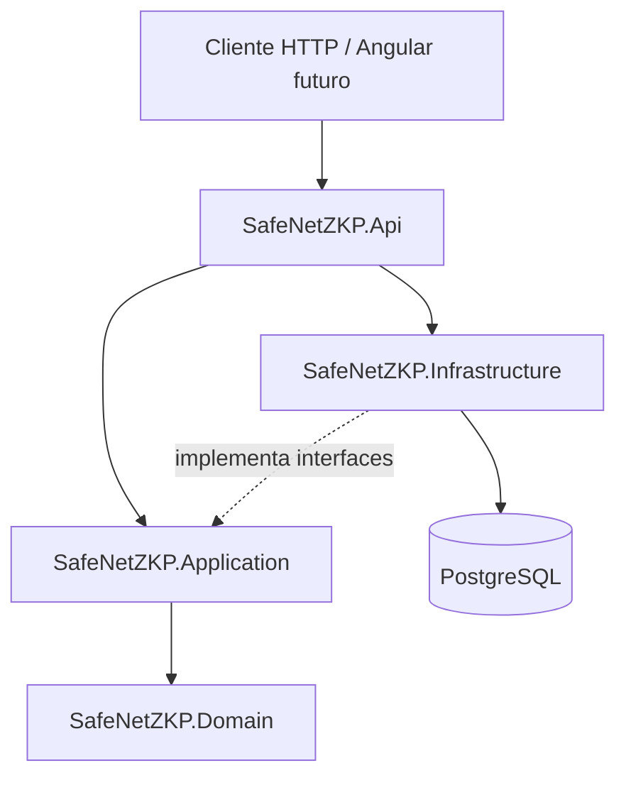

# SafeNet-ZKP

**Autenticação para redes Wi-Fi públicas com foco em privacidade — projeto acadêmico em desenvolvimento.**

O **SafeNet-ZKP** é um projeto de Trabalho de Conclusão de Curso (TCC) em **Redes de Computadores no Instituto Federal do Ceará (IFCE)**. A proposta é investigar uma alternativa aos fluxos tradicionais de cadastro em redes Wi-Fi públicas, por meio de um **portal cativo** com autenticação baseada em **FIDO2/WebAuthn**, além de estudar a **aplicabilidade de provas de conhecimento zero (Zero-Knowledge Proofs — ZKP)** para a preservação de privacidade.

> [!IMPORTANT]
> **Estado do projeto:** o backend inicial já oferece cadastro e consulta de usuários com persistência em PostgreSQL. O portal cativo, a autenticação FIDO2/WebAuthn, o frontend Angular e uma eventual aplicação de ZKP **ainda não estão implementados**. O uso de ZKP faz parte do estudo de viabilidade, não de uma funcionalidade concluída.

## Objetivo

Investigar e desenvolver uma base tecnológica para autenticação de usuários em redes Wi-Fi públicas, buscando reduzir a dependência de senhas e cadastros convencionais. A proposta considera a utilização de FIDO2/WebAuthn e a avaliação crítica de onde ZKP poderia agregar garantias de privacidade, levando em conta viabilidade técnica, limitações e requisitos de segurança.

## Tecnologias

| Camada / finalidade | Tecnologias |
| --- | --- |
| Backend | C#, .NET 10, ASP.NET Core Web API |
| Arquitetura | Separação em API, Application, Domain e Infrastructure (inspirada em Clean Architecture) |
| Persistência | Entity Framework Core 10, Npgsql, PostgreSQL 17 |
| Ambiente local | Docker, Docker Compose |
| Documentação da API | OpenAPI e Swagger UI |
| Testes | xUnit |
| Frontend planejado | Angular |
| Autenticação planejada | FIDO2 / WebAuthn |
| Pesquisa em privacidade | Provas de Conhecimento Zero (ZKP) |

## Arquitetura do backend



A solução está organizada por responsabilidades:

```text
SafeNet-ZKP/
├── SafeNetZKP.Api/                # Endpoints, DI, OpenAPI e tratamento HTTP
├── SafeNetZKP.Application/        # DTOs, interfaces e casos de uso
├── SafeNetZKP.Domain/             # Entidades e regras de domínio
├── SafeNetZKP.Infrastructure/     # EF Core, repositórios e migrations
├── tests/
│   ├── SafeNetZKP.UnitTests/
│   └── SafeNetZKP.IntegrationTests/
├── docker-compose.yml
└── SafeNetZKP.slnx
```

As dependências seguem esta direção:

- `Application → Domain`
- `Infrastructure → Application + Domain`
- `Api → Application + Infrastructure`

Os casos de uso dependem de `IUserRepository`, enquanto `PostgresUserRepository` fornece a implementação de persistência com Entity Framework Core. Dessa forma, o domínio e os casos de uso não precisam conhecer diretamente o PostgreSQL.

## Funcionalidades e estágio atual

| Funcionalidade | Situação |
| --- | --- |
| Estrutura inicial em camadas | Implementada |
| Cadastro de usuário (`POST /api/users`) | Implementado |
| Consulta de usuário por ID (`GET /api/users/{id}`) | Implementada |
| Persistência com EF Core e PostgreSQL | Implementada |
| Migrations iniciais | Implementadas |
| Validação básica da entrada e regras da entidade `User` | Implementada |
| Testes unitários de casos de uso e entidade | Implementados |
| Testes de integração automatizados e isolados | Em preparação |
| Tratamento e documentação completos de todos os erros HTTP | Em aprimoramento |
| Frontend Angular | Planejado |
| Integração com portal cativo | Planejada |
| Registro e autenticação FIDO2/WebAuthn | Planejados |
| Aplicabilidade e eventual prova de conceito com ZKP | Em estudo |

### Endpoints atuais

| Método | Rota | Descrição | Resposta principal |
| --- | --- | --- | --- |
| `GET` | `/api/health` | Verifica se a API responde; não testa a disponibilidade do banco | `200 OK` |
| `POST` | `/api/users` | Cria um usuário | `201 Created` |
| `GET` | `/api/users/{id}` | Busca um usuário pelo identificador | `200 OK` ou `404 Not Found` |

Exemplo de requisição para cadastro:

```http
POST /api/users
Content-Type: application/json

{
  "name": "Maria"
}
```

O cadastro retorna os campos `id`, `name` e `createdAt`. O formato e os códigos de erro estão em processo de padronização.

## Executando localmente

### Pré-requisitos

- .NET SDK 10;
- Docker Desktop ou Docker Engine com Docker Compose;
- Git;
- Ferramenta `dotnet-ef` compatível com o EF Core utilizado, para aplicar migrations.

> Os comandos abaixo devem ser executados na pasta da solução, onde estão `docker-compose.yml` e `SafeNetZKP.slnx`. No repositório atual do GitHub, essa pasta é `SafeNet-ZKP/`.

### 1. Clonar e acessar a solução

```powershell
git clone https://github.com/Edilson-EJ/SafeNet-ZKP.git
cd SafeNet-ZKP/SafeNet-ZKP
```

### 2. Configurar o PostgreSQL

Crie um arquivo `.env` **na pasta do `docker-compose.yml`** com os valores apropriados para o seu ambiente local:

```dotenv
POSTGRES_DB=safenet_zkp
POSTGRES_USER=safenet
POSTGRES_PASSWORD=DEFINA_UMA_SENHA_LOCAL
```

O arquivo `.env` deve permanecer fora do versionamento. O Compose utiliza essas variáveis para configurar o serviço PostgreSQL. Em uma instalação existente, **não altere a senha apenas no `.env`**: as credenciais de um volume PostgreSQL já inicializado não são redefinidas automaticamente.

Inicie o banco:

```powershell
docker compose up -d
```

Confirme o serviço:

```powershell
docker compose ps
```

A configuração de desenvolvimento publica a porta PostgreSQL no endereço de loopback (`127.0.0.1`), para uso local.

### 3. Configurar a conexão da API

A aplicação utiliza a chave `ConnectionStrings:DefaultConnection`. Em desenvolvimento, configure-a por meio de **User Secrets** no projeto `SafeNetZKP.Api`, utilizando o mesmo usuário e a mesma senha definidos para o banco local.

```powershell
dotnet user-secrets set "ConnectionStrings:DefaultConnection" "Host=127.0.0.1;Port=5432;Database=safenet_zkp;Username=safenet;Password=SUA_SENHA_LOCAL" --project .\SafeNetZKP.Api
```

Substitua `SUA_SENHA_LOCAL` pelo valor configurado localmente. **Evite utilizar credenciais reais em comandos compartilhados ou no histórico do terminal.** O User Secrets é destinado ao desenvolvimento, não constitui um cofre de segredos de produção e não é substituído automaticamente pelo `.env` do Docker Compose.

### 4. Aplicar as migrations

Com o PostgreSQL iniciado e a conexão da API configurada:

```powershell
dotnet ef database update --project .\SafeNetZKP.Infrastructure --startup-project .\SafeNetZKP.Api
```

Se a ferramenta `dotnet ef` não estiver disponível, instale uma versão compatível com os pacotes EF Core do projeto antes dessa etapa.

### 5. Iniciar a API

```powershell
dotnet run --project .\SafeNetZKP.Api
```

No perfil de desenvolvimento local utilizado durante a implementação, a API foi acessada em:

- Swagger UI: `http://localhost:5109/swagger`
- Health: `http://localhost:5109/api/health`

A porta efetiva pode variar de acordo com o perfil de inicialização. Confira a URL exibida no terminal. Para cenários fora do desenvolvimento local, configure HTTPS/TLS adequadamente.

## Testes

Os testes unitários verificam regras do domínio e casos de uso, utilizando repositórios falsos quando necessário:

```powershell
dotnet test .\tests\SafeNetZKP.UnitTests\SafeNetZKP.UnitTests.csproj
```

Os testes de integração com PostgreSQL estão em preparação. **Não execute automaticamente a suíte de integração contra um banco compartilhado:** ela exige uma conexão de teste exclusiva (`SAFENET_TEST_CONNECTION_STRING`), migrations e isolamento adequados.

## Próximas etapas

1. Aprimorar testes, contratos HTTP, documentação OpenAPI e tratamento de erros.
2. Definir requisitos de identidade, sessão, autenticação e autorização.
3. Projetar o modelo de credenciais e challenges para WebAuthn.
4. Implementar e testar o fluxo de registro e autenticação FIDO2/WebAuthn.
5. Integrar a experiência do usuário ao Angular e estudar a integração com portal cativo.
6. Avaliar tecnicamente a aplicabilidade de ZKP, delimitando afirmação, segredo, verificador e benefícios mensuráveis antes de decidir por uma prova de conceito.
7. Documentar metodologia, limitações e resultados experimentais do TCC.

## Contexto acadêmico

O SafeNet-ZKP faz parte de um trabalho acadêmico em Redes de Computadores no **Instituto Federal do Ceará (IFCE)**. O estudo está orientado à segurança e à privacidade em redes Wi-Fi públicas. A implementação e as avaliações serão documentadas progressivamente, distinguindo funcionalidades concluídas, funcionalidades previstas e hipóteses ainda não verificadas.

## Referências técnicas

- [W3C — Web Authentication (WebAuthn)](https://www.w3.org/TR/webauthn-3/)
- [FIDO Alliance — FIDO2](https://fidoalliance.org/fido2/)
- [Microsoft — Documentação do ASP.NET Core](https://learn.microsoft.com/aspnet/core/)
- [Microsoft — Entity Framework Core](https://learn.microsoft.com/ef/core/)
- [PostgreSQL — Documentação](https://www.postgresql.org/docs/)

---

**Status:** projeto acadêmico em desenvolvimento. A presença de tecnologias no roadmap não implica implementação ou validação de suas garantias de segurança.
