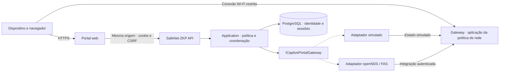
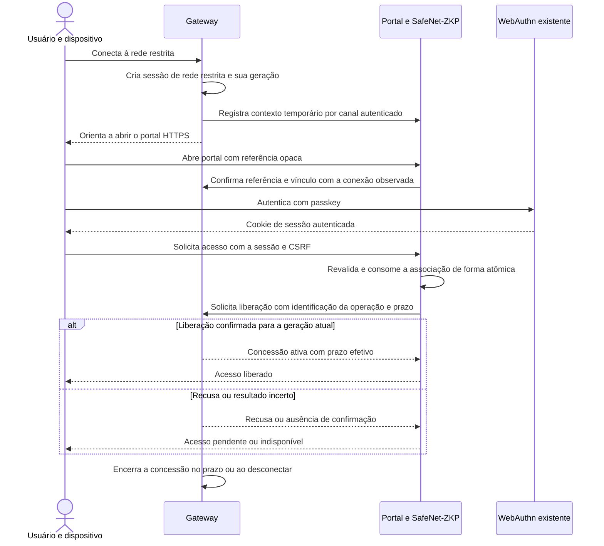

# Arquitetura do portal cativo

**Etapa 10.1 · Proposta para o protótipo acadêmico**

## Objetivo

Permitir que um usuário autenticado por passkey solicite acesso à internet para o dispositivo conectado à rede Wi-Fi restrita. A primeira implementação será validada com um gateway simulado. Uma etapa posterior vai avaliar OpenWrt com openNDS em uma rede de laboratório.

**A sessão autenticada responde quem é o usuário. A sessão de rede identifica qual conexão o gateway pode liberar.** Uma passkey verificada ou um cookie válido, por si só, não concede acesso à rede. O portal só anuncia a liberação após confirmação do gateway.

## Arquitetura e reaproveitamento



As duas opções de adaptador são alternativas de implantação. No simulador, o gateway e a aplicação da política são representados por estado controlado no laboratório. No cenário real, o gateway controla o tráfego e a API coordena a decisão.

| Componente | Responsabilidade | Reaproveitamento |
|---|---|---|
| Portal web | Exibir o estado, iniciar o login e enviar a solicitação de acesso na mesma origem da API | A página experimental ilustra a chamada WebAuthn. A interface futura terá seu próprio fluxo e não dependerá da página de teste. |
| Backend SafeNet-ZKP | Confirmar identidade e sessão, validar a associação ao dispositivo, aplicar a política e coordenar a operação com o gateway | Os controllers WebAuthn existentes verificam as passkeys. `HttpCurrentUserContext` implementa `ICurrentUserContext` e resolve a identidade a partir do principal. O esquema de cookies, a autorização e o CSRF continuam sendo a fronteira das operações do navegador. |
| Sessão autenticada | Representar a sessão do usuário, hoje com validade de 20 minutos, sem renovação automática | `AuthenticatedSession`, `AuthenticatedSessionService` e `IAuthenticatedSessionRepository`. A integração futura precisa expor internamente a referência da sessão já validada e seu prazo, sem repassar o valor bruto do ticket. |
| Sessão de rede | Representar uma conexão observada pelo gateway, com identidade opaca, geração, estado e prazo próprios | Conceito novo. Uma reconexão que exija nova autorização recebe outra geração. O vínculo usa a sessão autenticada específica e a tupla gateway, sessão de rede e geração. |
| Gateway | Observar a conexão e aplicar, expirar e retirar a liberação de tráfego | Fonte de verdade para a sessão de rede e a liberação efetiva. IP e MAC podem ser atributos observados internamente pelo gateway, com alcance local e validade limitada. |
| Adaptadores | Traduzir consulta, liberação e revogação em operações do simulador ou do equipamento | Porta de saída sugerida em Application. Implementações futuras em Infrastructure, selecionadas pela composição da API. |

O projeto **Domain** já define `User`, `WebAuthnCredential` e `AuthenticatedSession`. Uma futura regra de concessão pode viver no domínio sem depender de ASP.NET Core, EF Core ou openNDS. **Application** já fornece os contratos de identidade e persistência. **Infrastructure** implementa os repositórios PostgreSQL, os serviços FIDO2 e o cache de desafios. **Api** mantém o controle de HTTPS, cookies, autorização e rate limiting. O login e a inscrição WebAuthn funcionam hoje em Development. A escolha de como habilitar um laboratório real fica para uma etapa própria.

## Fluxo de autorização de rede



1. **Conectar e identificar.** O gateway começa com tráfego restrito e cria a sessão pela conexão que observa. No laboratório real, a rede pré-autorizada permite os destinos necessários para descoberta, DNS e portal HTTPS com certificado confiável. O acesso normal à internet permanece bloqueado.
2. **Abrir o portal.** O navegador recebe apenas uma referência opaca, curta e de uso único. O contexto correspondente é registrado pelo gateway em canal autenticado e vinculado a gateway, sessão, geração, finalidade, emissão e expiração. Se a referência entrar em uma URL, trocá-la por estado de navegação do servidor e redirecionar para uma URL limpa antes de navegar externamente. Impedir cache, propagação por `Referer` e registro de referências sensíveis.
3. **Confirmar o dispositivo.** Validar a procedência do contexto e comprovar que a navegação veio da conexão observada pelo gateway por um mecanismo confiável de ingresso ou desafio vinculado ao cliente nessa rede. O artefato de abertura sozinho é transferível e não prova essa posse. O vínculo deve sobreviver ao login no estado do servidor. Se a implantação não conseguir revalidar a conexão no momento da associação, manter o acesso restrito. No simulador, a associação é produzida pelo gateway fictício em ambiente controlado e sua validade fica limitada ao teste.
4. **Autenticar o usuário.** Reutilizar login WebAuthn e cookie existentes. Passkeys estão vinculadas ao RP. O portal e a API devem usar uma origem HTTPS compatível com o RP configurado. A troca para navegador completo, quando necessária, exige nova correlação confiável entre a navegação e o dispositivo.
5. **Associar e solicitar.** A ação do usuário deve ser um POST autenticado e protegido contra CSRF. O backend obtém do servidor a sessão autenticada e o contexto de rede, confirma que ambos continuam válidos e reserva atomicamente a associação. Os identificadores enviados pelo navegador são apenas referências. IP, MAC, cabeçalhos encaminhados por clientes e IDs arbitrários não autorizam acesso.
6. **Confirmar.** Enviar ao gateway uma operação idempotente para aquela geração. Aceitação de uma solicitação assíncrona significa pendência. Só apresentar acesso liberado depois de obter estado autoritativo da concessão, por consulta ou evento autenticado.
7. **Encerrar.** O gateway aplica um prazo local limitado ao menor entre o tempo restante da sessão autenticada, o máximo da política de rede e o limite do equipamento. Desconexão ou troca de geração encerra o acesso daquela conexão. Logout revoga a sessão autenticada e deve solicitar a revogação das concessões vinculadas a ela, por mecanismo confiável de entrega e reconciliação. Em caso de indisponibilidade, o prazo local limita o acesso residual. A confirmação da rede é independente do resultado do logout web.

### Falhas e concorrência

| Situação | Comportamento proposto |
|---|---|
| Gateway indisponível antes da liberação | Manter a restrição e mostrar indisponibilidade. Usar timeout e tentativas limitadas dentro do prazo original. |
| Timeout depois do envio | Tratar como resultado desconhecido. Consultar a mesma operação antes de declarar sucesso ou erro. Repetir apenas com a mesma chave e o mesmo conteúdo válidos. |
| Solicitação duplicada | Retornar o mesmo resultado ao mesmo contexto vinculado. Reutilizar a chave com conteúdo divergente gera conflito. A repetição não cria nova concessão nem estende a vigência. |
| Referência reutilizada, vencida ou apresentada por outra conexão | Recusar a associação, inclusive em corrida entre requisições. A reserva atômica permite uma única associação. Uma referência copiada ou a geração anterior não pode iniciar nova concessão. |
| Logout, reconexão ou expiração enquanto a solicitação está pendente | Invalidar a solicitação local e rejeitar confirmação tardia. O gateway deve rejeitar geração ou revisão obsoleta. Se uma liberação já estiver em vigor, reconciliar e revogar a concessão específica. |
| Revogação sem confirmação | Manter o estado de encerramento pendente, repetir de forma idempotente sem atingir uma concessão posterior e respeitar a expiração local no gateway. |

## Contratos sugeridos

`ICaptivePortalGateway` seria uma porta de saída de Application. As assinaturas abaixo são propostas de documentação.

| Operação | Entrada | Saída |
|---|---|---|
| `GetSessionAsync` | Gateway, referência interna da sessão de rede e geração | Estado observado, prazo e concessão vigente, ou sessão ausente |
| `AuthorizeAsync` | Sessão de rede e geração, ID da concessão, ID da operação, revisão, limite de validade da solicitação e expiração máxima do acesso | Aplicada, pendente ou recusada, com identificador de correlação |
| `GetOperationAsync` | Gateway e ID de operação já conhecido pelo backend | Pendente, confirmada, recusada, expirada ou desconhecida, com o prazo efetivo quando disponível |
| `RevokeAsync` | Sessão de rede e geração, ID da concessão, ID da operação de revogação e revisão | Encerrada, já encerrada, pendente ou recusada |

As operações aceitam cancelamento. Cancelar a espera local não cancela uma ação que já chegou ao gateway. A entrada de contextos ou notificações do gateway é uma fronteira distinta, autenticada e validada pelo adaptador. O contrato não transporta cookies, credenciais WebAuthn nem dados pessoais desnecessários.

Para o futuro canal entre serviços, preferir TLS mútuo com identidade segregada por gateway se a implantação permitir. Um agente de integração pode terminar esse canal quando o equipamento não oferecer a capacidade nativamente. Vincular cada mensagem à identidade do remetente, destinatário e operação, e verificar validade com tolerância de relógio limitada. A política deve manter o histórico de idempotência pelo menos durante a janela de aceitação de mensagens. Usar geração e revisão monotônica para ordenar concessão e revogação e impedir que mensagens atrasadas reabram o acesso. Somente o simulador em processo pode substituir o canal de rede por chamadas internas com origem controlada.

### Contrato implementado na etapa 10.2

A porta mantém as quatro operações propostas. `AuthorizeAsync` recebe também uma associação interna previamente verificada. `RevokeAsync` inclui o prazo da solicitação, assim como `AuthorizeAsync`. O identificador da operação permite consultar o resultado pelo gateway correspondente. Uma leitura retorna o estado observado naquele instante, portanto uma consulta posterior à expiração ou revogação nunca confirma uma concessão antiga como ativa.

No simulador, o ingresso emite uma instância de observação e uma referência aleatória temporária, armazenada apenas como hash. A associação precisa da instância original, da referência e da identidade fornecida pelo chamador confiável. A consulta retorna uma cópia informativa que não vale como prova. O primeiro vínculo consome a referência e fixa usuário e sessão autenticada durante a geração. Uma reconexão explícita invalida a geração anterior e permite nova associação. A referência GUID da sessão autenticada é interna e sintética nesta etapa. A etapa 10.3 precisa obter ou mapear uma referência de sessão a partir do contexto autenticado do servidor.

| Estado | Interpretação e transição |
|---|---|
| `Pending` | Reservado para adaptadores assíncronos. A consulta pode confirmar, recusar ou apontar encerramento. |
| `Indeterminate` | O chamador ainda desconhece o resultado. No cenário de timeout do simulador, o acesso já foi aplicado, mas a primeira resposta omite a concessão. A consulta ou uma repetição idêntica revela o estado vigente. |
| `Denied` | A solicitação foi recusada. Não há liberação para essa operação. |
| `Authorized` | Concessão ativa e confirmada. Pode expirar, ser revogada ou ser encerrada por mudança de geração. |
| `Expired` e `Revoked` | Estados terminais da concessão. Um novo acesso na mesma geração exige associação ainda válida, outra concessão, nova operação e revisão superior. |

O simulador serializa as alterações em um único processo e calcula prazos com `TimeProvider`. A revogação pode chegar antes da autorização e reservar o ID da concessão como encerrado, impedindo a aplicação de um comando atrasado. Os registros de operação e de concessão permanecem em memória até o encerramento do processo. O simulador não representa persistência, perda real de conectividade nem aplicação de política sobre tráfego.

O adaptador real deve validar a identidade do gateway no canal entre serviços, conferir geração, revisão, vigência e conteúdo das mensagens, e correlacionar confirmações com a concessão, o dispositivo e a operação esperados. A confirmação deve vir de consulta autoritativa ou evento autenticado que represente a política aplicada. A identidade do usuário e o contexto da sessão não devem ser repassados ao equipamento.

### Orquestração implementada na etapa 10.3

`NetworkAccessService` recebe um `ICurrentUserContext` confiável e o identificador extraído do ticket autenticado, em um `NetworkAccessCaller` criado no servidor. O serviço de sessões aplica a mesma condição de atividade usada pelo cookie e lê o vencimento persistido sem alterar o fluxo WebAuthn. Para manter o GUID previsto no contrato da etapa anterior, deriva uma referência interna de 128 bits a partir do hash SHA-256 do identificador. O identificador original não entra na associação nem nas operações do gateway. O vínculo exige a identidade e a sessão autenticada específica, inclusive para duas sessões do mesmo usuário.

`ICaptivePortalAssociationGateway` é uma porta separada para verificar a observação e consumir a referência uma única vez, de forma atômica. O caso de uso confere o vínculo retornado antes de criar uma associação utilizável. O adaptador simulado reutiliza a verificação da etapa 10.2. A origem da observação e do contexto autenticado pertence à composição confiável do servidor. O navegador nunca deve construir esses objetos.

Os objetos de operação são criados no servidor e retêm a mesma concessão, revisão, prazo e chave de idempotência ao repetir. A revisão e os limites de tempo são fornecidos pela composição confiável. O prazo de acesso é limitado pela sessão autenticada e pela conexão observada. Após o prazo de envio, uma repetição só consulta a operação. Confirmações precisam corresponder à operação, concessão e conexão esperadas. O caso de uso revalida a sessão antes de devolver acesso confirmado. Um timeout ou uma falha de transporte ao enviar ou consultar uma concessão resulta em `Indeterminate`. Falha na verificação da associação impede a concessão.

**Logout web e encerramento da rede continuam separados.** Uma sessão web revogada impede novas operações do usuário, inclusive confirmação tardia. Se o gateway já tiver aplicado acesso, ele pode mantê-lo até o vencimento local. O logout existente revoga o ticket no PostgreSQL, sem chamar o gateway. A revogação antecipada automática após logout exigirá um fluxo de serviço independente da sessão já revogada, entrega confiável e reconciliação. A ação explícita de revogar pelo caso de uso exige a sessão proprietária ativa.

Para a etapa 10.4, a composição deverá resolver o ticket no servidor, guardar associações e operações por sessão, alocar revisões concorrentes de modo seguro e reutilizar a operação durante uma repetição. Cada execução concorrente com PostgreSQL deve usar seu próprio escopo de repositório. O simulador e os objetos internos atuais perdem estado ao reiniciar. Antes de integrar múltiplas instâncias ou um gateway real, definir a persistência, a origem verificável da observação e a coordenação do encerramento de rede.

### Persistência e logout na etapa 10.4A

`PersistentNetworkAccessService` é a entrada de Application para o fluxo durável. A associação usa a prova viva verificada pelo gateway e grava gateway, conexão, geração, usuário, hash SHA-256 completo da sessão e datas UTC. Consultas e pedidos de revogação exigem a mesma sessão ativa, inclusive quando o usuário possui outras sessões. O hash, embora protegido contra a recuperação do identificador de alta entropia, é um dado interno. O banco não recebe o cookie, o identificador bruto nem a prova temporária. O vínculo histórico não tem exclusão em cascata a partir da sessão, para preservar revogações pendentes quando a retenção de sessões for definida.

A migration `20261120155643_AddPersistentNetworkAccess` cria `NetworkAccessAssociations` e `NetworkAccessOperations`. Aplicar a migration explicitamente antes de usar esta versão, inclusive para o logout web. A API não aplica migrations na inicialização.

- A associação é única por gateway, conexão e geração. Reservar uma autorização bloqueia primeiro a sessão ativa e depois a associação no PostgreSQL. As restrições únicas protegem a chave de idempotência por associação, a revisão e os IDs das concessões e revogações.
- A primeira reserva fixa o ID da operação, o ID da concessão, a revisão e os prazos. Repetir a chave preserva esses valores e não estende a vigência. A revisão seguinte fica reservada para revogação antes mesmo de o gateway confirmar o acesso. Após o prazo de envio, o caso de uso só consulta. Um reinício sem a observação viva permite consultar pedidos persistidos, mas não repetir o envio de autorização com uma prova recriada.
- A linha de operação funciona como **outbox da revogação**. A escrita que revoga a sessão web registra também a intenção de revogar todas as concessões potencialmente aplicadas daquela sessão, na mesma transação. O logout pode retornar `204` após o commit e a remoção do cookie. Esse retorno confirma o logout web. O estado da rede pode permanecer pendente.
- `NetworkRevocationProcessor` lê pedidos pendentes e indeterminados sem precisar de uma sessão web ativa. Consulta ou envia pelo mesmo ID de revogação e revisão, sem manter transação aberta durante a chamada ao gateway. Processos concorrentes podem repetir a entrega, que exige idempotência no gateway. Respostas sem correlação permanecem indeterminadas. Uma atualização condicional impede que uma confirmação de autorização atrasada substitua a intenção de revogar ou reabra um estado terminal.
- Para o laboratório, `CaptivePortal__ProcessRevocations=true` habilita em Development o consumidor em lotes após a aplicação da migration. Se estiver desativado, a intenção permanece persistida para processamento posterior. A perda do simulador impede confirmar operações antigas. Nesse caso o pedido pode permanecer indeterminado até o prazo máximo originalmente imposto à concessão. `Expired` registra esse limite, enquanto `Revoked` exige confirmação correlacionada do gateway. O adaptador real precisa garantir a vigência máxima no equipamento para essa distinção ser válida.

Na 10.4B, os endpoints devem extrair o principal e o identificador do ticket já validado, montar `NetworkAccessCaller` no servidor, resolver a observação em contexto confiável e reutilizar a chave de idempotência nas repetições. As operações que alteram estado devem exigir HTTPS e CSRF. A resposta ao cliente deve distinguir logout web, revogação de rede pendente, resultado indeterminado e confirmação. Ainda é necessário definir como reter a capacidade viva entre requisições e a política de retenção do histórico.

### API experimental na etapa 10.4B

As rotas abaixo usam o prefixo `/api/captive-portal` e só são registradas em Development. Exigem HTTPS e o cookie autenticado. Todos os POSTs exigem o cabeçalho `X-CSRF-TOKEN` obtido em `GET /api/auth/csrf`. O limite por IP e minuto é de 12 escritas e 60 leituras. As respostas não devem ser armazenadas em cache.

| Operação | Contrato |
|---|---|
| `POST /associations` | Recebe `reference` e retorna `201` com `associationId` apenas se houver uma observação preparada para a sessão e a associação for consumida com sucesso. |
| `POST /operations` | Recebe `associationId` e `idempotencyKey` (GUID). O servidor fixa até um minuto para envio e cinco minutos de acesso, limitados pelo vínculo e pela sessão. Repetir a mesma chave. Uma associação sem capacidade viva retorna `404`. Uma reserva recusada pelo estado da associação retorna `409`. |
| `GET /operations/{operationId}` | Consulta ou reconcilia operação da sessão atual. Retorna `200` com `operationId` e `state`. O campo `expiresAt` tem valor apenas quando o acesso está confirmado. |
| `GET /grants` | Lista até 50 registros da sessão atual em ordem recente, com `operationId`, `lastKnownState` e `accessUntil`. A lista descreve o histórico local. Consultar a operação para confirmar o estado atual. |
| `POST /operations/{operationId}/revocation` | Solicita revogação idempotente da operação pertencente à sessão. O processamento usa a fila transacional existente e precisa do consumidor configurado. |

Nas escritas de autorização e revogação, `202` com `Location` indica estado `pending` ou `indeterminate`. `200` informa estado confirmado ou terminal. Uma recusa do gateway pode retornar `403` com `denied`; uma operação ausente ou de outra sessão retorna `404`. A API revalida a sessão após o caso de uso. Quando detecta revogação durante a requisição, retorna `401` sem confirmação de acesso. Falha de armazenamento após a validação inicial pode retornar `503`; falha ao validar o cookie pode resultar em `401`. Um timeout do gateway após a reserva mantém a operação indeterminada.

`CaptivePortalIngress` recebe observações apenas de código confiável em processo, depois que esse produtor comprovar o vínculo da conexão à sessão web. Guarda a observação e o vínculo vivo por prazo limitado e chaves derivadas de hash. O navegador apenas localiza uma observação já preparada para sua sessão. O serviço de aplicação e o gateway ainda validam a instância da observação e o uso único da referência. Os testes preparam observações diretamente no simulador. A API atual não tem produtor HTTP ou integração de gateway que faça essa comprovação, portanto novas associações e autorizações ficam indisponíveis por padrão. A perda do cache impede novas utilizações da capacidade viva, mas as consultas e revogações continuam usando o estado persistido.

Na etapa 10.5, a interface pode consumir os estados e seguir `Location` para reconciliação. Deve diferenciar estado histórico e confirmado, mostrar que o logout web e o encerramento de rede são operações distintas, e manter as ações de associação bloqueadas enquanto não houver ingresso confiável configurado.

## Canal autenticado do gateway na etapa 11.2

`POST /api/captive-portal/gateway/observations` recebe observações de laboratório por HTTPS em Development. A credencial é uma chave HMAC-SHA256 de 32 bytes aleatórios por gateway e por implantação. O gateway autentica o servidor pelo certificado TLS. Configure o valor Base64 por provedor externo à árvore de código, como a variável `CaptivePortal__GatewayKeys__<uuid-do-gateway>`. Use UUID canônico em minúsculas. A presença de uma chave válida autoriza o gateway a reportar dentro do próprio espaço de conexões. Retirar a chave da configuração e recarregar o processo desabilita esse gateway. A proteção da chave, a rotação coordenada e o relógio sincronizado são responsabilidades do laboratório. Desative a captura de cabeçalhos e corpos dessa rota em proxies e ferramentas de diagnóstico.

Envie `Content-Type: application/json`, sem query string ou compressão. O corpo é JSON UTF-8, com até 2048 bytes, contendo exatamente `gatewayId` e `connectionId` como UUIDs e `generation` como inteiro positivo de 64 bits. A identidade da conexão é a tupla gateway, conexão e geração. A API exige que o gateway do corpo seja o mesmo autenticado pelo cabeçalho. IDs de conexão de gateways distintos pertencem a espaços independentes.

| Cabeçalho | Valor |
|---|---|
| `X-SafeNet-Gateway` | UUID do gateway, formato D em minúsculas |
| `X-SafeNet-Timestamp` | Segundos Unix em decimal canônico, sem sinal ou zeros à esquerda. Tolerância de 60 segundos em cada direção |
| `X-SafeNet-Nonce` | 16 bytes aleatórios em 32 dígitos hexadecimais minúsculos. Gere um novo para cada mensagem |
| `X-SafeNet-Signature` | HMAC-SHA256 de 32 bytes em 64 dígitos hexadecimais minúsculos |

Calcule o SHA-256 sobre os bytes exatos transmitidos no corpo e represente o resultado em hexadecimal minúsculo. A entrada ASCII do HMAC contém as seguintes linhas separadas por LF, sem LF final. Substitua os quatro campos entre chaves pelos valores reais.

```text
safenet-gateway-observation-v1
POST
/api/captive-portal/gateway/observations
{gateway}
{timestamp}
{nonce}
{sha256-do-corpo}
```

`204` confirma a gravação da observação, cuja validade termina 120 segundos após o timestamp assinado. `401` indica assinatura ou metadados de autenticação inválidos, `403` indica HTTP sem TLS ou identidade do corpo divergente, `409` indica nonce já gravado e `503` indica indisponibilidade do armazenamento. O limite compartilhado da rota é de 120 requisições por minuto por instância de API e pode devolver `429`. Uma perda da resposta pode deixar a gravação já confirmada no banco. Reenviar os mesmos bytes e cabeçalhos dentro da janela preserva a proteção contra duplicação.

A migration `AddGatewayObservations` deve ser aplicada explicitamente no banco do ambiente autorizado. A chave primária em `(GatewayId, Nonce)` e o `INSERT ... ON CONFLICT DO NOTHING` reservam o nonce e gravam a observação juntos. Essa proteção vale entre processos e após reinício. A tabela não guarda chaves, assinaturas ou cookies. O índice de expiração permite manutenção posterior. Nesta etapa a limpeza é manual, com a ingestão parada e requisições encerradas. Remova apenas registros vencidos com margem para desvio ou correção do relógio. Cada gateway com uma chave comprometida pode reportar conexões em seu próprio espaço até a revogação da chave.

### Prova de vínculo para a associação futura

A gravação autenticada não produz a capacidade viva consumida por `ICaptivePortalAssociationGateway`. Antes de chamar `CaptivePortalIngress.StageObservation`, uma integração futura deve identificar a conexão e a geração pelo ingresso confiável da rede. Uma opção é um proxy de ingresso autenticado perante o backend, com identidade vinculada ao gateway. O gateway associa o tráfego daquele navegador à conexão por contexto controlado do acesso à rede e atesta ao backend um desafio curto que o backend vinculou à sessão WebAuthn verificada. O backend exige a mesma identidade de gateway, mesma conexão e geração, observação vigente e desafio ainda válido. O mecanismo depende de o equipamento distinguir conexões no ingresso, inclusive quando clientes compartilham endereço. Um desafio copiado ou um cabeçalho que o cliente possa enviar não prova a origem.

Depois de obter essa prova, o adaptador deve emitir uma referência aleatória de 32 bytes, armazenada como hash e ligada à tupla da conexão, à sessão web verificada e à finalidade de associação. A validade deve ser limitada a um minuto e aos prazos da sessão e da observação. O adaptador entrega a capacidade viva ao `CaptivePortalIngress` e consome a referência atomicamente por `ICaptivePortalAssociationGateway`. Os serviços existentes continuam responsáveis pela reserva, autorização, consulta e revogação. Nesta etapa a rota de observações não abre nenhuma associação para navegadores. O fluxo de associação em Development continua disponível somente para observações já preparadas por código interno confiável.

O pipeline HTTP exercita assinatura válida, gateway desconhecido, chave errada, corpo adulterado, timestamps fora da janela, replay sequencial e concorrente, tentativa de reivindicar outro gateway, HTTP sem TLS, falha do repositório, fabricação de associação por navegador e ausência da rota em Production. O teste PostgreSQL do repositório usa duas conexões para verificar a reserva concorrente quando o banco isolado está disponível.

## Vínculo de laboratório na etapa 11.3

O simulador representa a confirmação de origem pela entrega da instância viva da observação ao ingresso interno confiável. O produtor de laboratório seleciona a sessão web previamente validada e emite a referência para o correlator dessa sessão. O correlator é derivado do hash do identificador interno e serve apenas para comparar o vínculo. A autenticação do usuário continua usando o cookie WebAuthn e o registro ativo da sessão. A autenticação HMAC confirma a origem do relato do gateway. Os dois controles têm funções independentes.

O simulador gera 32 bytes aleatórios e guarda apenas o hash, o correlator da sessão e o vencimento, limitado a um minuto e ao prazo da observação. A referência fica no estado da conexão e da geração observadas. Um único bloqueio protege emissão, consumo e reconexão. Uma referência em vigor impede nova emissão para a mesma geração. No consumo, o gateway compara a observação original, a geração, o hash e o correlator da sessão. O backend valida a sessão ativa antes e depois da chamada ao gateway. O ingresso ainda verifica a sessão e o prazo ao buscar a observação preparada. Um logout impede o uso do vínculo pela sessão encerrada. Uma sessão nova, inclusive do mesmo usuário em outro navegador, exige nova prova e referência. Uma reconexão invalida referências e concessões da geração anterior.

O PostgreSQL já registra a associação concluída com unicidade por gateway, conexão e geração. Na gravação, o repositório bloqueia a linha da sessão e verifica sua vigência enquanto disputa o mesmo bloqueio usado pelo logout. A prova e as referências pendentes de laboratório permanecem em memória. Após reiniciar a API, o ingresso vazio exige nova confirmação confiável para preparar outra observação. Consultas e revogações de operações persistidas continuam pelo fluxo existente. Uma falha após o consumo no simulador deixa a referência consumida. A recuperação exige um novo fluxo confiável, eventualmente com uma nova geração. Esse desenho impede reuso e aceita a perda de disponibilidade da tentativa quando consumo e persistência não podem ser confirmados juntos.

### Entrega ao navegador e confirmação do gateway real

Um redirecionamento controlado pode encaminhar o navegador à página HTTPS do portal. Para vincular a navegação, o backend deve criar um desafio com prazo curto, ligado à sessão web verificada. O ingresso autenticado deve atestar a tupla da conexão para a mesma requisição de resgate em que o backend valida a sessão e o desafio. O gateway precisa identificar a conexão e a geração a partir do contexto da rede que controla, inclusive entre clientes que compartilham endereço. Uma confirmação separada de que alguém apresentou o desafio permitiria retransmissão. O backend deve comparar a autenticação do ingresso, a requisição e a observação vigente, e consumir o desafio uma única vez. Um proxy de laboratório que termine TLS para esse fim fará parte da fronteira de confiança da aplicação. Ele deve descartar metadados de ingresso fornecidos pelo cliente e encaminhar a informação verificada por um canal autenticado ao backend.

Só depois dessa confirmação o adaptador pode emitir a referência de associação para a sessão vinculada. Uma entrega possível é em resposta HTTPS de mesma origem sem cache, mantendo a referência fora de URLs, histórico, logs e cabeçalhos Referer. A submissão continua pelo POST autenticado e protegido contra CSRF. Segredos HMAC ficam no provedor de configuração do gateway e do backend. O navegador recebe apenas a referência de uso único. O vínculo atesta o ingresso observado durante o desafio, com as garantias que o equipamento oferecer. Um redirecionamento ou uma referência transferível por si só deixam a origem sem confirmação.

O endpoint de relatos HMAC permanece separado do ingresso de associação. A etapa não adiciona produtor HTTP para referências de associação. Os testes internos e HTTP exercitam a sessão correta, referências fabricadas, expiradas e repetidas, concorrência entre sessões, isolamento entre gateways, reconexão, logout durante associação, falha de escrita e perda da referência após reinício mesmo com uma sessão ainda válida.

## Resiliência, auditoria e retenção na etapa 11.4

- **Autorização.** Uma reserva fica em `Pending` até haver resultado. Uma falha de transporte ou de correlação produz `Indeterminate`. Se o gateway perder o estado, uma consulta não reutiliza a confirmação anterior. Uma autorização já confirmada continua em modo de consulta mesmo após ser marcada indeterminada. A repetição de uma autorização ainda sem confirmação reutiliza a mesma chave, a mesma operação, a mesma concessão e a mesma revisão, somente enquanto o prazo de envio e o vínculo vivo permitem. O backend não reexecuta automaticamente inscrições, login, logout ou transações completas.
- **Revogação.** O logout grava a intenção na mesma transação da sessão. O worker consulta primeiro a operação de revogação, pode enviar uma vez por passagem com o mesmo ID e revisão e usa até dois segundos de espera cooperativa por item entre consulta e envio. O adaptador deve respeitar cancelamento e prazo. A fila processa até 32 por lote, com intervalo de cinco segundos. Falhas de banco são retomadas em outro escopo, em lote posterior. Se o gateway confirmar e o banco falhar antes de salvar o resultado, a consulta seguinte pode recuperar a confirmação. Uma resposta atrasada ou concorrente não pode substituir o estado terminal persistido.
- **Divergência e expiração.** A perda do estado simulado deixa a concessão ou revogação indeterminada até nova evidência ou o prazo máximo de acesso. `Revoked` exige resposta correlacionada. `Expired` indica que o limite local foi alcançado. Para um adaptador real, a garantia de fim do acesso depende de o gateway aplicar esse limite mesmo offline, manter o histórico idempotente e expor uma consulta autoritativa após reinício. A lista de concessões expõe o último estado conhecido. A consulta individual reconcilia o estado atual.
- **Auditoria.** Os eventos estruturados usam controller, ação, código HTTP, estado de rede quando disponível e identificador de rastreamento da requisição. No gateway, `401` agrupa falhas de autenticação e `409` distingue replay. No WebAuthn, as ações de início e conclusão distinguem cadastro e login. O worker registra início, indisponibilidade do armazenamento e contagens por resultado no lote. O handler global registra somente o tipo da exceção e a correlação. Mantenha desativada a coleta de corpos, cabeçalhos e parâmetros sensíveis por proxies, EF Core e exportadores.

### Política proposta de retenção

- **Provas transitórias.** Desafios WebAuthn, tickets de inscrição e referências de associação expiram nos prazos da emissão. O cache de ingresso é volátil. Reinícios exigem nova prova para referências pendentes.
- **Sessões.** Consulte sempre o vencimento e a revogação. Como ponto de partida de laboratório, mantenha metadados de sessões encerradas por até sete dias. Antes da remoção em lotes, confira a existência da intenção durável para concessões ainda reconciliáveis. Preserve a fila e as associações referenciadas. Não arquive hashes de sessão em logs.
- **Observações e nonces.** Preserve o registro do nonce pelo menos enquanto a mensagem puder ser aceita, incluindo desvio de relógio e requisições em trânsito. Proposta de laboratório de sete dias após o vencimento, com limpeza manual enquanto a ingestão estiver parada e drenada. Preserve somente a trilha mínima necessária para investigações autorizadas.
- **Operações e vínculos.** Preserve indefinidamente `Pending` e `Indeterminate` que ainda precisem de reconciliação. Preserve também casos cuja expiração física ainda não esteja comprovada pelo contrato do gateway. Para registros terminais elegíveis, proponha 30 dias a partir da última transição, com retenção adicional para incidentes e exclusão em lotes na ordem operações, associações e sessões elegíveis. Antes de automatizar, valide a seleção em modo somente leitura e teste com um banco isolado. Nenhuma exclusão automática foi introduzida.
- **Chaves.** Antes do piloto físico, defina inventário e custódia por gateway e ambiente, rotação coordenada, revogação em incidente e descarte de material antigo. Defina também quais operadores podem acessar a trilha e por quanto tempo ela permanece disponível.

## Revisão final de chaves e retenção na etapa 11.5

- **Provisionamento e revogação do gateway.** Use material aleatório exclusivo por identidade e ambiente, em Base64 canônico. A API rejeita assinaturas de identidades que compartilham a mesma chave configurada. Para desabilitar um gateway, remova sua chave do provedor efetivo e reinicie as instâncias. Confirme que nenhuma configuração de menor precedência reintroduz a entrada. A remoção impede novas observações autenticadas e mantém o histórico e os nonces para auditoria. Em caso de incidente, revise observações e operações relacionadas e trate suas concessões pelo fluxo de revogação apropriado.
- **Rotação.** O protocolo atual admite uma chave por identidade. No laboratório, pause o emissor, substitua a chave nos dois lados, reinicie as instâncias com a configuração nova e verifique autenticação com a chave nova e rejeição da anterior. Preserve os nonces durante a rotação. Se houver necessidade de sobreposição, evolua o protocolo para assinar também um identificador de chave, com janela curta de dupla aceitação e retirada imediata em incidentes. Mantenha o nonce único por gateway durante a janela.
- **Data Protection.** As chaves que protegem cookies e CSRF são independentes das chaves HMAC. O host usa o armazenamento padrão do ASP.NET Core. Confirme o perfil, o isolamento e a proteção das chaves no ambiente real de laboratório antes de depender da continuidade de cookies. Para implantações separadas ou múltiplas instâncias, planeje um conjunto de chaves persistente por ambiente, acesso restrito, proteção em repouso e recuperação controlada. O reinício com chaves estáveis ainda exige que a sessão no banco esteja ativa. Desafios WebAuthn e provas de ingresso pendentes continuam voláteis.
- **Retenção.** Sete dias para sessões encerradas e observações vencidas e 30 dias para operações terminais são pontos de partida operacionais, condicionados à finalidade de auditoria. Para sessões, conte a partir da revogação ou expiração que as encerrou. Para observações e nonces, conte a partir do vencimento e preserve a margem de relógio e tráfego em trânsito. Para operações, conte a partir da última transição e preserve linhas relacionadas a revogações ainda reconciliáveis, a incidentes e a expirações sem garantia física. Antes de qualquer rotina de exclusão, valide a consulta de elegibilidade com dados de teste e revise as dependências e a janela de idempotência. Nenhuma rotina de limpeza é executada pela API.

## Validação operacional na etapa 11.6

O nome da aplicação no Data Protection inclui o ambiente e a raiz de conteúdo. Preserve ambos e o conjunto de chaves nos reinícios de uma implantação. Use repositórios de chaves e identidades de serviço separados entre implantações, inclusive entre dois laboratórios no mesmo ambiente ASP.NET. O nome da aplicação não impede um operador com acesso a todo o material de chave de reproduzir esse nome em outro processo.

A troca de chaves HMAC mantém a identidade do gateway e a chave única de replay `(GatewayId, Nonce)`. Reassinar uma mensagem já aceita com a chave nova não libera o nonce. Desabilitar a chave impede novas observações autenticadas. O histórico e as operações persistidas continuam disponíveis aos seus fluxos de consulta e revogação. A retirada da chave de observação não confirma revogação de acesso. Em incidente, trate concessões existentes e use confirmação independente do gateway. A separação de segredos entre instalações depende do provisionamento. Production mantém a rota experimental ausente.

### Diagnóstico somente leitura de retenção

Use uma conexão já validada para `safenet_zkp_test` em `127.0.0.1:5433` e um papel somente leitura. O resumo conta registros potencialmente elegíveis e omite identificadores. O esquema atual não contém marcação de investigação. Portanto, nenhuma contagem autoriza remoção. Cruze com os registros de incidentes antes de qualquer uso da seleção. As consultas são conservadoras e preservam observações e sessões ligadas a uma associação. Para avaliar a ação operacional sobre nonces, pause a ingestão em todas as instâncias, drene requisições em trânsito, verifique o relógio e repita o diagnóstico. A janela de sete dias pressupõe relógios estáveis e não autoriza purgar registros recuperados após alteração significativa do relógio.

```sql
BEGIN TRANSACTION ISOLATION LEVEL REPEATABLE READ READ ONLY;

SELECT count(*) AS sessoes_encerradas_sem_vinculo
FROM "AuthenticatedSessions" AS s
WHERE LEAST(s."ExpiresAt", COALESCE(s."RevokedAt", s."ExpiresAt"))
      < CURRENT_TIMESTAMP - interval '7 days'
  AND NOT EXISTS (
      SELECT 1 FROM "NetworkAccessAssociations" AS a
      WHERE a."UserId" = s."UserId" AND a."SessionHash" = s."IdHash"
  );

SELECT count(*) AS observacoes_e_nonces_vencidos_sem_vinculo
FROM "GatewayObservations" AS g
WHERE g."ExpiresAt" < CURRENT_TIMESTAMP - interval '7 days'
  AND NOT EXISTS (
      SELECT 1 FROM "NetworkAccessAssociations" AS a
      WHERE (a."GatewayId", a."ConnectionId", a."Generation")
          = (g."GatewayId", g."ConnectionId", g."Generation")
  );

-- NetworkAccessState persistido. 2 = Denied, 5 = Revoked.
-- Inclui recusas sem concessão e revogações confirmadas. Exclui Expired local.
SELECT count(*) AS operacoes_terminais_com_evidencia
FROM "NetworkAccessOperations" AS o
WHERE o."UpdatedAt" < CURRENT_TIMESTAMP - interval '30 days'
  AND o."AccessUntil" < CURRENT_TIMESTAMP
  AND ((o."State" = 2 AND o."GrantState" IS NULL AND o."RevocationId" IS NULL)
       OR o."RevocationState" = 5);

ROLLBACK;
```

## Padrões e integração openNDS

| Referência | Escopo e implicação |
|---|---|
| RFC 8952 | Documento informativo de arquitetura. Orienta a separação entre provisionamento, API consultada pelo cliente, portal do usuário e aplicação da política. [RFC 8952](https://www.rfc-editor.org/rfc/rfc8952) |
| RFC 8908 | Padrão para a API CAPPORT consultada pelo cliente. Exige TLS com certificado válido, resposta `application/captive+json` e campo `captive`. Pode fornecer a URL do portal e o tempo restante. O estado deve refletir o dispositivo consultado e a aplicação efetiva da política. [RFC 8908, §§ 4–5](https://www.rfc-editor.org/rfc/rfc8908#section-4) |
| RFC 8910 | Padrão de descoberta da URI da API CAPPORT via DHCPv4 (opção 114), DHCPv6 e anúncios de roteador IPv6. A URI provisionada aponta para a API de estado, distinta da página de login. [RFC 8910, § 2](https://www.rfc-editor.org/rfc/rfc8910#section-2) |
| openNDS/FAS | Integração de fornecedor. O FAS verifica as credenciais e o openNDS aplica a liberação no firewall. A documentação descreve HTTPS e Authmon nos níveis 3 e 4 do FAS. Avaliar o modo suportado pela versão escolhida e validar em laboratório como obter confirmação, revogar e impor a vigência efetiva. [Documentação oficial do FAS](https://opennds.readthedocs.io/en/stable/fas.html) |

Passkeys, cookie de 20 minutos, associação de uso único, canal entre serviços e política de concessões são decisões do SafeNet-ZKP. A API CAPPORT para clientes e o contrato interno de comando do gateway têm finalidades distintas. A simulação inicial não implica conformidade CAPPORT nem compatibilidade verificada com FAS.

## Comparação, riscos e limitações

| Aspecto | Simulado | OpenWrt com openNDS |
|---|---|---|
| Origem da sessão de rede | Eventos sintéticos emitidos pelo simulador | Conexão observada pelo gateway e traduzida pelo adaptador |
| Efeito da concessão | Transição de estado verificável | Liberação de tráfego aplicada no equipamento |
| Prazo e revogação | Relógio controlado e falhas determinísticas | Resolução de prazo e confirmação dependentes da versão e do mecanismo disponível. Arredondar para baixo ou recusar a liberação se o prazo máximo não puder ser respeitado. |
| Cobertura | Exercita regras, concorrência e falhas da aplicação | Exige validar descoberta, IPv4 e IPv6, isolamento, DNS, portal HTTPS, restrições pré-autorização e comportamento de clientes reais |

- **Vínculo com o dispositivo.** A passkey identifica o usuário. A força do vínculo com a conexão depende do gateway e da topologia. Endereços podem mudar ou ser compartilhados. Sem comprovação confiável, o cenário fica restrito à demonstração.
- **Compatibilidade.** Mininavegadores de detecção de portal podem ter suporte incompleto a passkeys ou fechar ao detectar internet. Testar os sistemas-alvo e uma abertura segura no navegador completo.
- **Disponibilidade e observabilidade.** A API e o gateway podem divergir temporariamente. Registrar resultados e IDs de correlação internos, sem cookies ou referências de abertura, e definir reconciliação e retenção antes de persistir dados de rede. O cache WebAuthn e o rate limiting hoje são locais ao processo.

## Plano incremental

1. **10.2 · Simulação da política.** Implementar a porta e o adaptador em memória com relógio controlável, sob identidade de teste. Exercitar o caso de uso de associação, consulta, concessão e revogação. A aceitação exige confirmação explícita para o sucesso e testes de dois dispositivos, uso único, geração obsoleta, duplicata concorrente, timeout com resultado desconhecido, expiração e revogação. Começar sem portal público ou integração com firewall.
2. **Protótipo integrado.** Definir estado durável para associações, operações e revogação, incluindo recuperação após reinício. Integrar a interface HTTPS à autenticação existente e validar separadamente logout web e encerramento de rede com o simulador.
3. **Laboratório OpenWrt.** Fixar versões de OpenWrt/openNDS e testar FAS/Authmon, prova de vínculo, prazos, consulta e revogação em rede isolada. Só então incorporar descoberta e API CAPPORT conforme a interoperabilidade exigida e testar o tráfego real.

### Questões em aberto

- Qual domínio, RP ID e conjunto de navegadores serão usados no laboratório? O que fazer quando o navegador do portal não oferecer WebAuthn?
- Qual mecanismo do gateway comprovará o vínculo da navegação com a conexão, inclusive na passagem para o navegador completo?
- Quais são os prazos máximos de abertura, autorização e acesso? Qual política de reconexão e retenção se aplica às concessões?
- A versão de openNDS escolhida oferece confirmação e revogação suficientes para o contrato? Como o agente será autenticado e como as chaves serão provisionadas e rotacionadas?
